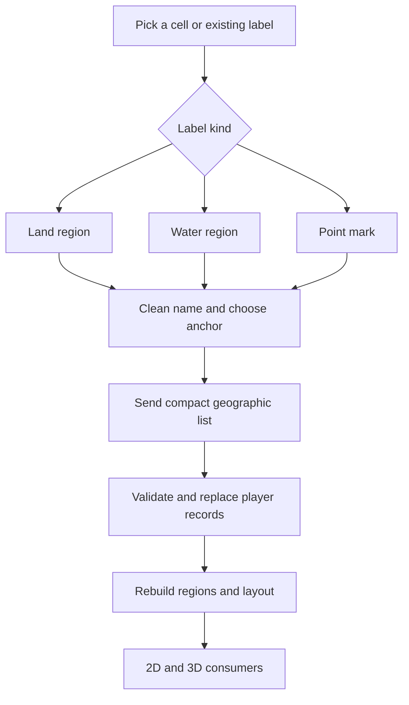

# Names, geography and flags

[All topics](../../GAME_DESIGN.md) · [Catalog](../../catalog.json) · [Sources](../../SOURCES.md) · [Evidence](../../research/extraction-customization.json)

> ID: `DOC-CUSTOMIZATION`. Build: 2.1.4. Package: `WP-CUSTOMIZATION`.

Customization changes display names and flag artwork while retaining target identity. Geographic names use a separate set of player records, cultural automatic records and real-Earth labels. The source paths below are traced; isolated checks exercise finite fixtures. Actual rendered editing and a live multiplayer session remain unobserved. [SRC-250–255]

## Entity names

| Kind | Target and displayed value | Original-name behavior |
| --- | --- | --- |
| `state` | State looked up by stable UID, `name` | First custom value stores `onm`; restoration puts it back and removes `onm` |
| `gov` | State UID, `govNm` or localized government name | A distinct custom label uses `govNm`; restoring removes it |
| `city` | Cell index, `cityInfo`, `cityMeta` and `cityNames` | Metadata retains the original and current name for the site |
| `person` | Person ID through the people subsystem | Uses `personRename` and that subsystem's original-name record |
| `dyn` | Dynasty ID and its short name | Uses `dynastyRename` and the dynasty original-name record |
| `cul` | Culture ID greater than zero, `name` | Uses `onm` for first-original restoration |
| `rel` | Religion ID greater than zero, `name` | Uses `onm` for first-original restoration |

Each kind has a lookup and an apply handler. Missing targets are ignored. State renaming updates stored sides in current wars and generated war titles; authored titles are not universally replaced. It also notifies the people subsystem. A name change does not allocate another state, person, culture or religion ID. [SRC-250]

`ncClean` removes controls, zero-width characters and markup-sensitive punctuation, collapses whitespace, trims and truncates to 32 UTF-16 code units. A surrogate pair at the boundary can be split. The dialog rejects an empty edited name. The registered `rename` action sanitizes again and uses empty input as the original-name restoration request. The UI and action therefore have different empty-input roles. Lookup returns `{cur,orig}` so the dialog can expose restoration only when it is applicable. [SRC-250, SRC-254, SRC-255]

Rename and flag buttons refer to the state currently displayed by the inspector. Refresh invalidates rendering and UI caches after applying changes. Government labels are presentation values rather than another government type; their downstream display uses `govNm` before the built-in translated name. Culture and religion persistence includes their optional original names in the existing society tuples. [SRC-250]

## Flag representation and editor

The editor works on 24x16 pixels, 384 palette indexes. Stored flags are keyed by stable state UID in `NC_FLAGS`. A record contains dimensions, a palette, pixel indexes, a version and a cached URI. Validation first coerces dimensions and pixel entries through bitwise integer conversion. It then requires dimensions from 4 to 64 on each axis, at most 32 hex colors and exactly `w*h` in-range palette indexes. Fractional entries truncate; nonnumeric pixel entries can become zero. Invalid action payloads leave the previous flag intact. Sending null restores the automatic flag. The action does not require that its UID currently identifies a live state. [SRC-251, SRC-254, SRC-255]

| Editor control | Behavior |
| --- | --- |
| Brush | Sizes one, two or three pixels |
| Fill | Four-neighbor flood fill of the selected connected color |
| Eraser | Paints the state's main color through the same stroke path |
| Picker | Selects a pixel's color; right-click also picks |
| Undo | Palette and pixel snapshots, at most sixteen; button and Ctrl+Z share the stack |
| Templates | `hb` horizontal stripes, `vb` vertical stripes, `cross`, `nord`, `canton`, `diag`, `sun` disc, `star`, `moon` crescent and star |
| Palette | State main/light/dark colors followed by sixteen shared swatches; compacts unused colors and uses nearest squared RGB distance at the cap |
| Save | Sends dimensions, palette and indexes through the `flag` action |
| Automatic | Sends a null flag to remove the custom record |

An existing 24x16 custom flag supplies the initial grid. Otherwise the current automatic flag is rasterized and mapped to the state colors. The palette accepts six-digit `#rrggbb`; erasing paints the main state color rather than introducing transparency. The editor's canvas and URI caches are separate from the stored pixel representation. `ncFlagsChanged` invalidates consumers after an accepted action. The evidence checks logical state, template pixels and cache versioning; it does not establish a rendered canvas result. [SRC-251, SRC-255]

## Player geography

A player record is `{id,k,c,n,s}`. `k` is `land`, `water` or `mark`; `c` is an anchor cell, `n` the cleaned name and `s` the point-label size. The world cap is 200 records. Land and water labels resolve to geographic regions. A mark retains the selected location. The edit dialog can rename, remove or move an existing label. Pen controls and N enter selection; Esc ends it. Selection checks retained 2D/3D label hit boxes before the map cell. [SRC-252]

Connected landmasses and water basins determine regional membership. Reattachment searches up to two cells for the same element. Directly anchored records have priority over a record being reattached. When records compete for a component, ordering favors greater previous area, then earlier year, then lower ID. Region placement uses interior distance and horizontal fit; broad oceans remain near their anchor. Large regions that span map edges can split into substantial pieces. Text size shrinks to fit the available space. These are placement rules, not a measured guarantee against every visual overlap. [SRC-252, SRC-253]

Player labels have precedence over automatic cultural names at their anchors. Real-Earth labels use separate ID bands and are also suppressed where a player record covers their region. `MAP_OV.geo` controls geographic labels as a group; `geoAuto` and `geoReal` select additional sources. Both `drawGeoLabels` and `updateGeoLabels3D` obtain their data through `ncGeoLabels`. Chronicle, inspector and walking text can resolve a place through `ncGeoNameAt`; cell naming has an Earth-name fallback. [SRC-252, SRC-253]

## Cultural automatic names

The normal automatic pass runs every five years. It requires at least 300 population for a naming claim. Another root culture must reach at least 65 percent dominance and hold the claim for 150 years before changing an established name. Sleeping records remain for more than 400 years before removal; the list is capped at 160. Water-mask changes can force an earlier geographic reassessment. [SRC-253]

Names deterministically combine a root syllable and indexed suffix, with separate land/water forms and language presentation. The generator avoids duplicate names and current city/state names. Records retain their linguistic and geographic inputs so language changes can reconstruct the display. The region kind also uses size thresholds and hysteresis; every tuning constant is retained in the evidence JSON. [SRC-253]

Automatic record attachment preserves continuity through component changes. Older saves without automatic-name data can create names silently rather than replaying a chronicle of first discoveries. The real-Earth path obtains named regions and seas from `earthGeo`, with area-based font sizes clamped by geographic kind. This extends the previously extracted [real-Earth naming rules](../simulation/real-earth.md). [SRC-120, SRC-253]

## Persistence and network boundaries

| State | Representation |
| --- | --- |
| Entity names | Existing state/city/people/dynasty/society fields and their original-name fields |
| Flags | `ext.custom={v:1,flags:[[uid,w,h,palette,base64Pixels],...]}`; at most 300 saved records |
| Player places | `ext.custom.geo`; compact rows `[kind,x,y,name]`, with mark size appended |
| Automatic places | `ext.custom.auto={y,list,e?}`; rows retain kind, anchor, linguistic indexes, cultural root, dates, area and contest/sleep state |

Flag loading reconstructs the validated palette/pixel record rather than retaining a stale URI. The save selection favors live states when enforcing the stored-flag limit. Player geographic loading validates kind, integer coordinates, bounds, cleaned nonempty names and point size. New-world generation clears both player and automatic geographic records. A society reset retains player geography and clears cultural automatic names. [SRC-251, SRC-254]

The three registered customization actions are `rename`, `flag` and `geoList`. UI changes use `netDo`; the shared callbacks validate and apply them. Offline actions run directly. In a room they are ordinary editor commands: the client path requires edit rights, and the host checks the sender's editor role before queuing them. They are outside the host-only and walking-action sets. Their callbacks do not restrict an editor to names or flags of a personally owned state. `geoList` sends the complete compact player list, then the receiver replaces its player records and allocates fresh local record IDs. Save/network rows retain coordinates and names rather than those IDs. A late or repeated full-list edit therefore has different merge semantics from a single-entity rename. Local callback checks do not prove successful transport in a live room. [SRC-254]

## Verification boundaries

The portable report retains source hashes, line ranges, constants, palettes, registered actions and the executed checks. Tests cover source logic with finite entity, map, DOM, canvas and delivery adapters. A separate negative control changes the name limit to one character to confirm that the name assertions detect a broken rule. [SRC-255]

Full editor input and visual templates, long-lived cultural claims on a full world, changing coastlines, label collision behavior in both views, save migration on disk and concurrent edits by real clients remain open. All three features retain `runtime_verified=false`. [SRC-250–255]

## Complete customization constants

These are the loader/editor and geographic tuning declarations. Display sizes are retained alongside simulation thresholds without treating them as observed visual results. [SRC-250–253]

| Constant | Value |
| --- | --- |
| `NAME_MAX` | `32` |
| `FLAG_W` | `24` |
| `FLAG_H` | `16` |
| `FLAG_PAL_MAX` | `32` |
| `FLAG_SAVE_MAX` | `300` |
| `FLAG_SCALE` | `4` |
| `UNDO` | `16` |
| `CELL_PX` | `20` |
| `GEO_MAX` | `200` |
| `GEO_REANCHOR` | `2` |
| `GEO_OCEAN` | `0.05` |
| `GEO_OCEAN_MIN` | `300` |
| `GEO_SEA` | `0.008` |
| `GEO_SEA_MIN` | `40` |
| `GEO_LOCAL_CAP` | `6` |
| `GEO_LOCAL_K` | `0.22` |
| `GEO_SPLIT_MIN` | `30` |
| `GEO_FIT_K` | `10` |
| `GEO_FS` | `[9.5,40,10.5,24]` |
| `GEO_MARK_FS` | `[11.5,14.5,19.5]` |
| `GEO_CAPS` | `14` |
| `GEO_PIECE` | `0.25` |
| `GEO_PIECE_MIN` | `12` |
| `REAL_FS` | `{"c":[14.5,22],"o":[16,24],"s":[10.5,13.5],"l":[10.5,12.5],"i":[10.5,16]}` |
| `AUTO_EVERY` | `5` |
| `AUTO_POP` | `300` |
| `AUTO_ISLE` | `0.0015` |
| `AUTO_ISLE_MIN` | `6` |
| `AUTO_LAKE` | `0.0005` |
| `AUTO_LAKE_MIN` | `5` |
| `AUTO_MERGE` | `0.5` |
| `AUTO_CORE` | `6` |
| `AUTO_OCEAN_BIG` | `0.12` |
| `AUTO_KIND_HYST` | `1.2` |
| `AUTO_DOM` | `0.65` |
| `AUTO_RENAME_Y` | `150` |
| `AUTO_KEEP_Y` | `400` |
| `AUTO_MAX` | `160` |
| `AUTO_FS` | `0.92` |

The shared palette and complete geographic style object are retained in the [evidence JSON](../../research/extraction-customization.json).

The isolated probe completed 53 checks successfully; the negative control triggered 17 expected failing assertions. Person/dynasty internals are traced statically and their callbacks use fixtures here. [SRC-255]
