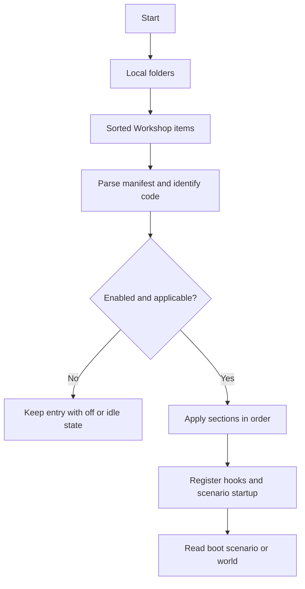
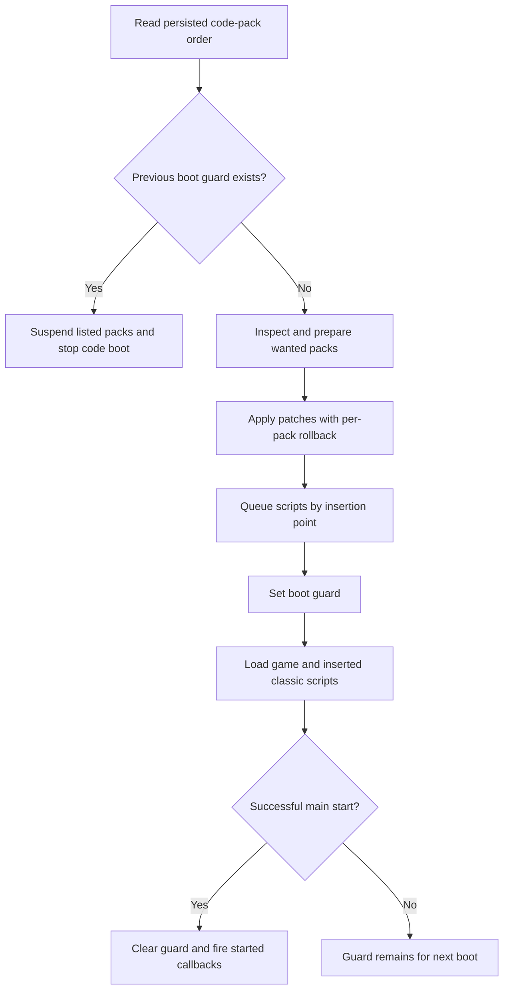

# Data, code, editor and Workshop

[All topics](../../GAME_DESIGN.md) · [Catalog](../../catalog.json) · [Sources](../../SOURCES.md) · [Evidence](../../research/extraction-modding.json)

> ID: `DOC-MODDING`. Build: 2.1.4. Package: `WP-MODDING`.

This describes the shipped loaders and editor. Static traces and isolated checks support the rules below. Full game startup, actual file operations, image decoding and Steam Workshop service results remain unobserved. The official example is disabled by default. Its content is an extension example rather than a base simulation rule. [SRC-003, SRC-243, SRC-249]

## Discovery and application

`main.start` calls `modsInit` before reading the boot scenario. Local add-ons load first, in immediate-directory enumeration order. Available Workshop items follow, sorted lexicographically by `String(id)`. Repeated directories or Workshop IDs are skipped. A local folder whose `workshop.id` identifies the same subscribed item is treated as its duplicate. Other ID collisions receive a Workshop ID or folder suffix, truncated to 64 characters. This is not a dependency resolver or a mod priority interface. [SRC-243, SRC-248]

The section order is `scenarios`, names, `eras`, `balance`, `vis`, `biomes`, `models`, `roads`, `buildings`, `vehicles`, textures/sounds/music, `species`, `worlds`, then `events`. Each section catches its own exception. A failed section does not roll back earlier data sections or stop subsequent ones. Later numeric and visual overrides replace matching values. Custom biome, species, building and vehicle keys also have collision rules; a single universal conflict policy would describe them incorrectly. [SRC-243]

Normal choices live under `earthsim.mods`, with keys `local:<id>` or `ws:<id>`. An explicit saved choice overrides `disabledByDefault`. Changes require restart because data is applied once. Code-bearing packs additionally require their code to be enabled and live in the current boot; their data can remain idle until restart. The demo guards local loading, Workshop loading and editor entry independently. Workshop loading also returns during `netLive()`. [SRC-248]

## Manifest and validation

A data pack is a directory containing `mod.json`. Legacy code-only directories have a separate fallback. The loaders consume the following top-level fields; unknown fields are not rejected by a JSON schema. [SRC-243, SRC-245]

| Fields | Meaning |
| --- | --- |
| `id`, `name`, `author`, `description` or `desc`, `version` | Identity and presentation |
| `disabledByDefault`, `eraLadder` | Default enable choice and old-ladder compatibility |
| `scenarios`, `worlds`, `events` | Goals, packaged saves and scheduled actions |
| `names`, `nameParts`, `personNames`, `cityNames` | Naming pools |
| `balance`, `eras`, `vis`, `biomes`, `species` | Simulation parameters and definitions |
| `models`, `roads`, `buildings`, `vehicles`, `textures`, `sounds`, `music` | Presentation resources |
| `code` | Script insertion and source patches |

Metadata limits are ID 40 characters, name 60, author 40, description 240 and version 16. A missing usable ID falls back to `mod` plus the current `MODS.length`. Text sanitation strips controls, bidirectional markers and markup-sensitive characters, normalizes whitespace and avoids a trailing half-surrogate. Bilingual values select the current language with fallback. `modValidate(raw, dir)` runs the data application path with `dry=true` and returns `{warnings, counts, error}`. Dry validation cannot prove an image loads or a model renders. [SRC-243]

Relative paths normalize backslashes. They reject empty/nonstring values, more than 260 characters, any `..` substring, drive/root/tilde prefixes and prohibited control or filename characters. Desktop file probes check both lexical containment and resolved real-path containment, file type and size. Missing filesystem access is a separate result. These checks are not a sandbox for enabled JavaScript code. [SRC-243, SRC-245]

### Balance and era compatibility

`balance` accepts only existing own numeric parameters and numeric arrays of exactly matching length. Values clamp to `[-1e6, 1e6]`; nonfinite values, unknown parameters and unavailable modules warn and skip. The section maps `civ/climate/ecology/currents/society/disasters/fauna/people/walk/stats/sound/music/trade` to `CIV/CLIM/ECO/CUR/SOC/DIS/FAU/PPL/WALK/STAT/SND/MUS/TRADE`. Dry validation counts an accepted override without mutating the table. [SRC-243, SRC-249]

Absent `eraLadder`, or a value below 2, enables legacy era conversion while the built-in ladder has eight eras. Custom `eras.tech` requires 1 to 11 numeric thresholds; the number of eras is one more. `names.ru`, `agri`, `military`, `seafaring` and `transition` must each have that length. English names fall back to Russian. Nonincreasing thresholds issue a warning but do not reject the ladder. `transition` clamps to `[0, .999]`, optional `techSpeed` to `[.01, 100]`, optional `cityCap` to `[.001, 10]`; optional `look` rounds to the six visual eras, 0 to 5. The loader updates the era tables and clears the built-in ladder flag. [SRC-243]

`vis` overrides existing visual keys using `#rrggbb` and era indices 0 to 32. The editor snapshots stock balance and era visuals before `modsInit`, so its displayed defaults do not inherit an already applied pack. [SRC-243, SRC-247]

### Biomes and species

| Definition | Accepted data and bounds |
| --- | --- |
| Biome identity | At most 24 per pack; key contains letters, digits or underscore, length 32; unique against the global biome table |
| Biome appearance | Required `color`, optional `colorLush`, `texture`, localized names capped at 40 |
| Biome simulation | `arable` and `rough` in `[0,1]`, `priority` in `[-100,100]` |
| Biome envelope | `when.temp` in `[-90,90]`, `precip` in `[0,6000]`, `height` in `[0,1]`, `slope` in `[0,2]`; endpoints are sorted; optional boolean `water` and `coast` |
| Biome vegetation | Built-in `conifer`, `broadleaf`, `jungle`, `bush`, `field`, or sprite; density rounds to `[0,8]`; sprite width/height in `[.1,3]` |
| Species identity | At most 16; key length 24; unique globally; required guild and optional recognized model |
| Species habitat | Temperature `[-90,90]`, precipitation `[0,6000]`, up to 64 biome weights in `[0,1]`, or three sea weights for deep water/shelf/reef |
| Species population and motion | Herd endpoints round to `[1,500]`; size/speed `[.1,10]`; danger `[0,1]`; `domestic` requires literal `true` |
| Species dynamics | Optional `dens` `[.001,1e5]`, `r` `[.01,2]`, `vuln` `[.05,20]` |

Species registration requires `faunaAddSpecies`; a false/negative result or exception rejects that species. Invalid models fall back by guild. During dry validation, a pack's already registered biome/species keys are excluded from self-conflicts. The evidence JSON preserves the complete guild and model lists. [SRC-243]

### Models, buildings, vehicles and media

Models accept an OBJ path, `{obj, texture}`, a map by era 0 to 32, or vehicle-only variant lists capped at 64 per kind/era. OBJ parsing reads positions, normals and UVs, accepts negative indices, triangulates polygon fans, inverts V and normalizes to a unit bounding cube centered horizontally at floor height. Material files are ignored. An `f` line and extension check can pass before geometry parsing; dry/no-THREE validation does not establish usable geometry. Model caching uses path, size and modification time. [SRC-243]

Buildings are capped at 12. Keys have length 24 and are unique globally. `replaces` accepts `house`, `tent`, `factory`, `tower`, `landmark`; `tier` accepts `any`, `village`, `center`, `city`. Era limits are 0 to 32, chance `[.01,1]`, size `[.2,4]`. Vehicles are capped at 400 per pack with a cumulative 160 MiB OBJ budget. They require an accepted replacement kind; chance is `[.01,1]`, size `[.3,3]`. The evidence JSON records every replacement kind and the subset used by 3D road traffic. [SRC-243]

Terrain/road textures accept PNG, JPG, JPEG or WebP. Roads use era indices 0 to 32 and repeating textures. Sounds replace accepted SFX events; the sound module can supply the event list, with a loader fallback recorded in the evidence. Music accepts MP3, OGG, WAV, M4A and FLAC, at most twelve tracks. It installs a replacement music list only when at least one track loads. Names append sanitized pools, capped at 400 for nation, person and city names and 200 per name-part list. [SRC-243]

Scenario goals, conditions, event effects and their saved schedule are covered in [Scripted events](../menu/scripted-events.md). Data caps include twelve scenarios, six goals per scenario, 32 events per list, eight worlds, six defeat conditions, twelve starting states and 48 locked tools. [SRC-237, SRC-243]

## Packaged worlds and heightmaps

World entries use `<modKey>::<relative-file>`. They require dimensions 24 to 220 on each axis; duplicate IDs are skipped. A visible world entry replaces a hidden scenario entry for the same file. Header lookup caches by path/size/mtime, reads at most 65536 compressed bytes, expands a header at most 1 MiB and searches at most 8192 characters before `arrays`. Unusual layouts use full checked reading. Full files and gzip output are each capped at 64 MiB. [SRC-244]

`modWorldCheck` returns a sanitized save or null. It accepts `{w,h,arrays}` with a valid `elev` field as the minimum structure. Each array record is `{t,b}`, where `t` is one of eight approved typed-array constructors and `b` is base64 with the exact byte length for `w*h`. It uses a shared four-million-node sanitation budget. Float ranges, integer indices and scalar bounds are preserved in the evidence tables. Invalid arrays are dropped; losing `elev` rejects the save. [SRC-244, SRC-249]

State records are capped at 512 with integer IDs 0 to 511. Only alive declared states retain cell ownership, and their cell sets are rebuilt from the ownership array. State history caps at 80 entries and resource lists at 32. World chronicle caps at 600, current wars at 200 and historical wars at 400. Known extension shapes are checked, including cultures/religions capped at 249, inventions at 512, disasters at 40 and statistics row capacity at 65536. Saved `ext.goals` and `ext.mods` are stripped, so packaged scenario progression and event counters do not transfer blindly. [SRC-244]

Starting a listed world writes a unique temporary SaveStore entry, clears pause, records its key in `earthsim.modworld` and calls `bootLoadMap`. Scenario world startup can wait for a late entry, but `_mWorldTried` prevents another attempt after an actual read. Grid dimensions must match. Consumed temporary saves and heightmap transfer data are cleaned up by startup hooks. No real save file was written in the isolated checks. [SRC-244, SRC-248]

Heightmap input can be RGBA pixels or a decoded browser image. Canvas conversion downsizes the largest side to 1024 pixels. Each output cell averages source pixels using `(.299R + .587G + .114B) * alpha / 255`, then divides by 255. Transparent pixels act as black. Inversion applies before classification. A mask uses luminance `>.5` for land; otherwise land requires luminance strictly above the selected threshold. [SRC-244]

For luminance `l`, sea level `S`, threshold `q` and gamma `g`, unmasked land uses `t=(l-q)/(1-q)` and masked land uses `t=l`. Its elevation is `S+.012+(1-S-.012)*clamp01(t)^g`. Water uses `S*(.42+.5*clamp01(t))`, with `t=l/q` without a mask and `t=l` with a mask. Size clamps to 24 to 220, sea to `[.2,.7]`, threshold to `[.005,.95]`, gamma to `[.3,4]` and smoothing to zero to four passes. Function defaults are 80x60, `.4`, `.08`, `1.4` and one pass. Smoothing uses a 3x3 neighborhood with center weight four and all other weights one, clipping at the edge. [SRC-244]

Heightmap transfer stores `{w,h,sea,d}` under `earthsim.heightmap`, quantizes elevation to Uint16 0 to 65535 and validates exact dimensions/byte length. Application sets sea level and `poleCold=0`. Fallback generation recomputes terrain and dependent natural systems, settles 46 steps, resets the year to zero and emits `worldgen('heightmap')`. The editor starts with 96x72, threshold 8 percent, one smoothing pass and inversion off; its creation path uses sea level `.4`. [SRC-244, SRC-247]

## Code packs and startup

The boot API is version 1. `code.scripts` contains strings or `{file, after, before}` objects; `after` wins if both are present. Unspecified placement defaults after `'*'`. `code.minGame` is a string compared as dotted integer components, with invalid or absent components treated as zero. Early `three.min.js`, `i18n.js`, `demomode.js` and `modboot.js` cannot be patched or used as insertion positions. `units.js` also loads before the boot loader but is absent from that denylist; the actual script order remains a separate constraint. [SRC-245]

Patches accept `find` or `anchor`. Operation precedence is `replace/replacement`, `insertBefore`, `insertAfter`, `insertBeforeFile/beforeFile`, then `insertAfterFile/afterFile`. Normalized records are `{file,find,op,text,textFile}`. A unique exact anchor wins. If absent, an anchor with at least twelve non-whitespace characters can match a unique whitespace-squashed occurrence. Multiple exact hits fail. Patches operate on shared in-memory game text, so later packs see earlier edits. Failure restores all text touched by the current pack. Syntax is checked after patching. Earlier successful packs remain applied. [SRC-245, SRC-249]

Legacy anchor packs and legacy script-index packs have discovery paths. Numbered line-patch formats are detected and rejected as unsupported. Compatibility preparation checks directories, files, size, syntax, insertion points and minimum version. The code signature includes script text and patch targets/anchors/text but omits the patch operation and insertion position; it does not fully identify placement semantics. [SRC-245]

Code choices use `earthsim.codemods` with path, name, `on` and optional `suspended`. New discoveries default off, including subscriptions. Wanted packs follow persisted `Object.keys` order. A previous `earthsim.codemods.boot` guard suspends the listed packs, or all wanted packs if necessary, and aborts code boot. Explicit re-enabling clears suspension. Insertion marks scripts with `data-modcode=1`; original patched script elements are disabled before replacements run. A pack execution failure skips its remaining scripts. These are source-level failure paths, not evidence of a successfully restarted game. [SRC-245, SRC-248]

## ModAPI

| API | Behavior |
| --- | --- |
| `api`, `version`, `report()` | API version, game version and pack key/name/status/failure summaries |
| `on(event, fn)` | Registers with `simOn`, or queues until it exists |
| `walkOn(event, fn)` | Registers with `waOn`, or queues until it exists |
| `wrap(name, wrapper, owner)` | Wraps the current global function; wrapper receives `orig` and arguments |
| `before(name, fn, owner)` | Returning literal `false` suppresses the original |
| `after(name, fn, owner)` | Receives original result followed by arguments; undefined preserves that result |
| `ready(fn)` | Queues a callback for loaded scripts before world creation |
| `started(fn)` | Queues a callback after successful main startup |

Wrappers preserve `this` and arguments. On the first wrapper exception, that wrapper is permanently bypassed. If it already called the original, its last original result is returned; otherwise the original runs as fallback. `__modOrig` retains the captured function. Startup callbacks are drained once and individual errors are caught. This behavior does not promise that arbitrary direct event callbacks cannot affect other systems. [SRC-246, SRC-249]

## Editor and publication

The editor exposes thirteen tabs: Overview, Details, Publishing, Scenarios, Worlds, Events, Balance, Eras, Names, Wildlife, Era look, Biomes and Files. Their exact IDs and labels are in the evidence JSON. File-oriented content includes models, roads, buildings, vehicles, textures, sounds and music. Opening a manifest normalizes supported shapes, records dropped sections and presents validation results. The display of a section does not establish that its resources are accepted or active. [SRC-247]

Folder IDs lowercase, replace invalid runs with hyphens, trim edge hyphens and cap at 40 characters. New manifests set `eraLadder:2`. Saving checks identity, occupied folders, unreadable manifests and replacement conflicts; renaming moves the whole folder. Free-name selection starts at suffix `-2` with a bounded search. File import saves first, validates size, sanitizes the filename and copies into a chosen subdirectory. Folder summaries stop at 3000 files and recursion depth six. [SRC-247]

Drafts use `earthsim.modedit.draft.<key>` and `{ts,json}`, with `__new` for a new pack. Retention removes the oldest timestamps to keep six entries. Validation uses loader warnings/counts and checks empty IDs, a JSON safety threshold of `.97 * 512 KiB`, unreadable manifests, scenarios without usable goals, era shape, dropped sections and immediately satisfied or defeated conditions. Testing saves, enables the local pack and boots the selected scenario, or an 80x60 continents map. [SRC-247, SRC-249]

Copying a pack copies its directory but omits root `workshop.id`, changes its identity/name and writes a manifest. JSON import copies only referenced resources plus `preview.png` when a source path is available. Publication previews are centered 640x360 crops. Unlinking publication removes only the local identity file; it leaves the remote item intact. [SRC-247]

`workshop.id` accepts digits and is independent of local enable choices and subscriptions. Publishing requires the Steam bridge, successful validation and save, then an explicit create/update prompt. A new item is requested hidden; updating preserves its visibility. `WSPUB_ID` is persisted before upload completes so a failed upload can retry the same item. `WSPUB_OK` clears the note; other terminal responses show mapped errors. The bridge sends pipe-delimited `WSPUBLISH` with folder, title, description, existing ID and note. It replaces pipes in title/description, validates numeric IDs and strips pipe/newline characters from notes capped at 500 characters. [SRC-247, SRC-248]

On Steam readiness the bridge requests `WSLIST`; item, pending and end messages build a list and notify the loader. Pending downloads trigger another refresh after 20000 ms. Failure/exit settles an unavailable list. Local removal is guarded to an immediate child of the mods root and recursively removes that folder. Workshop entries direct the player to the item page to unsubscribe; deleting subscription files is not an unsubscribe operation. No subscription, publication or removal was performed in this extraction. [SRC-248]

## Verification boundaries

The portable evidence records 50 successful isolated checks. They cover validation and data overrides, dry-run immutability, patch matching/rollback/syntax failure, wrapper fallback, world sanitation, synthetic heightmap pixels, editor defaults/drafts and enable/code states. A negative control bypassed path validation and produced two expected failing checks. Source hashes and ranges bind these results to the inspected files. [SRC-249]

Actual editor rendering, browser image decoding, symlink and permission behavior on disk, full legacy-pack startup, multiplayer compatibility and native Steam publication/download behavior remain open. The reference installation contains additional local content; it was not treated as a base rule or run. `runtime_verified` remains false. [SRC-243, SRC-245, SRC-247, SRC-248, SRC-249]

## Resource byte limits

| Resource | Maximum bytes |
| --- | ---: |
| `tex` | 8388608 |
| `snd` | 4194304 |
| `mus` | 25165824 |
| `obj` | 12582912 |
| `world` | 67108864 |
| `thumb` | 1048576 |
| `json` | 524288 |
| `code` | 4194304 |

The separate track-count cap is twelve. Code boot also caps the combined script text of one pack at 16 MiB; vehicle OBJ files have a separate 160 MiB cumulative budget. [SRC-243, SRC-245]

## Complete world field clamps

Array entries below clamp to the listed bounds. Scalar ranges apply only to accepted numeric fields; pause uses a separate literal-boolean rule. The evidence also retains every accepted typed-array constructor and its byte width. [SRC-244]

### Array fields

| Field | Minimum | Maximum |
| --- | ---: | ---: |
| `elev` | 0 | 1 |
| `riverFlux` | 0 | 1 |
| `volcanic` | 0 | 1 |
| `veg` | 0 | 1 |
| `fertility` | 0 | 1 |
| `eco` | 0 | 1 |
| `unrest` | 0 | 1 |
| `disease` | 0 | 1 |
| `pollution` | 0 | 1 |
| `fallout` | 0 | 1 |
| `herb` | 0 | 1 |
| `pred` | 0 | 1 |
| `fish` | 0 | 1 |
| `ruin` | 0 | 1 |
| `fire` | 0 | 1 |
| `adapt` | 0 | 1 |
| `baseTemp` | -150 | 150 |
| `sst` | -150 | 150 |
| `temp` | -150 | 150 |
| `tempSmoothed` | -150 | 150 |
| `tempForce` | -150 | 150 |
| `tempPulse` | -150 | 150 |
| `precip` | 0 | 30000 |
| `precipSmoothed` | 0 | 30000 |
| `humidity` | 0 | 5000 |
| `precipMul` | 0.01 | 50 |
| `pAnom` | 0.01 | 50 |
| `stir` | -50 | 50 |
| `curAddU` | -50 | 50 |
| `curAddV` | -50 | 50 |
| `windAddU` | -50 | 50 |
| `windAddV` | -50 | 50 |
| `pop` | 0 | 100000000 |
| `urban` | 0 | 100000000 |
| `foodCapS` | 0 | 1000000000 |
| `industry` | 0 | 10000 |

### Scalar fields

| Field | Minimum | Maximum |
| --- | ---: | ---: |
| `co2` | 0.2 | 6 |
| `solar` | 0.5 | 1.6 |
| `seaLevel` | 0.05 | 0.95 |
| `globalForce` | -30 | 30 |
| `tiltMul` | 0 | 3 |
| `windMul` | 0 | 3 |
| `currentMul` | 0 | 3 |
| `poleCold` | 0 | 40 |
| `co2ppm` | 0 | 5000 |
| `globalEmissions` | 0 | 1000000000 |
| `ecoGlobal` | 0 | 1 |
| `simYear` | -1000000 | 10000000 |
| `simTick` | 0 | 1000000000000 |
| `dayOfYear` | 0 | 360 |
| `seasonPhase` | -1 | 1 |
| `nukeWinter` | 0 | 20 |
| `pace` | 0.1 | 10 |
| `dynSea` | 0 | 1 |
| `seaBase` | 0.05 | 0.95 |
| `seaRefT` | -100 | 1000000000 |
| `disasterRate` | 0 | 3 |
| `aerosol` | 0 | 20 |
| `faunaAuto` | 0 | 1 |
| `faunaRich` | -1 | 2 |
