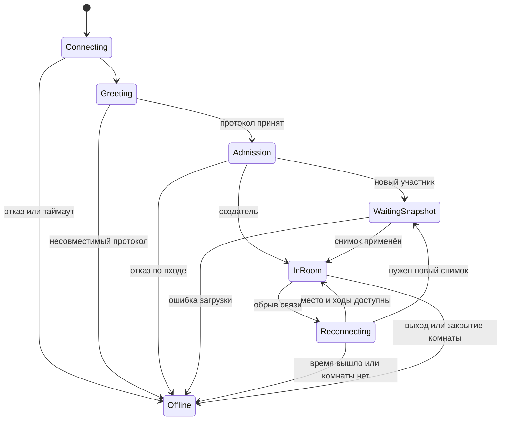

# Сетевые комнаты, синхронизация и восстановление

[Все темы](../../GAME_DESIGN.md) · [Каталог](../../catalog.json) · [Источники](../../SOURCES.md) · [Машинный отчёт](../../research/extraction-network.json)

> ID `DOC-NETWORK-ROOMS-SYNC`. Версия 2.1.4. Прослежены шесть фичей и 68 диапазонов исходников. Прошли 65 изолированных проверок. Статус `static_traced_runtime_pending`. [SRC-211–218]

## Сервер и подключение

Каждый участник считает собственную копию мира. Ведущий назначает очередной номер хода и целевое виртуальное время. Сервер хранит комнаты и недавние ходы, проверяет ведущего и порядковый номер, затем рассылает принятый ход. Ведущий исполняет собственный ход после получения этой рассылки. [SRC-213, SRC-215]

| Подключение | Настройки поставки |
| --- | --- |
| Интернет | В меню объявлен общий сервер WSS на порту 2278. Маршрут NW.js использует Node TLS и заданный в поставке сертификат. Готовность сервиса не измерялась. |
| Отдельный сервер | Node запускает `netserver.js`. По умолчанию порт 2278 и адрес `0.0.0.0`. Пара ключа и сертификата включает TLS. Пределы по умолчанию составляют 200 комнат и 2000 соединений. |
| Встроенная LAN-комната | Требует NW.js и доступного `require`. Перебирает порты 2279–2291, создаёт один сервер на одну комнату с пределом 32 соединения. Адрес прямого входа без порта получает 2279. |
| Обнаружение LAN | UDP IPv4 на порту 34782. Объявление каждые 2 секунды. Клиент объединяет адреса по идентификатору сервера и удаляет адрес после 7 секунд без объявления. |

Объявления идут на общий широковещательный адрес и на широковещательные адреса интерфейсов IPv4. Для своего адреса подключение выбирает loopback. Для чужих адресов приоритет имеют `192.168.*`, затем `10.*`, затем приватные адреса `172.16–31.*`. При отказе или таймауте интерфейс может попробовать следующий адрес того же LAN-сервера. Срок ожидания приветствия клиента составляет 7 секунд, ответа на привязанный запрос — 8 секунд. [SRC-211]

Приветствие несёт протокол 3, версию игры, имя и подпись дополнений. Протокол проверяется при приветствии, версия и подпись сверяются при входе в конкретную комнату. Подпись строится по отсортированным активным записям дополнений, включая подписи успешно загруженного кода. При установленной проверке Steam клиент запрашивает билет перед входом или созданием. Сервер имеет отдельные ветви для отказа Steam и недоступности сервиса. Реальные ответы Steam остаются для наблюдения. [SRC-211, SRC-212, SRC-215]

## Создание комнаты и вход

Создатель выбирает текущий мир, новое начало или сохранение. Сервер хранит имя, размер карты, год, состав, ведущего и режим редактирования для новых участников. Вместимость ограничена 2–16 местами. Право редактирования по умолчанию для новых участников задаёт настройка комнаты. При изменении этой настройки уже выданные роли сохраняются. [SRC-212, SRC-213]

Перед входом интерфейс запрашивает проверку комнаты. Она проверяет доступ и возвращает параметры мира без занятия места. В комнате с паролем сервер выдаёт соль и одноразовое число. Клиент рассчитывает проверочное значение через PBKDF2 с 20 000 итераций и отвечает HMAC. Успешная проверка готовит параметры загрузки, затем приложение перезапускает сцену с сетевым входом. После `joined` новый участник ожидает снимок. [SRC-212, SRC-216]

`Offline` обозначает локальный режим. При отказе на входе комната ещё не открыта. При разрыве активной комнаты локальная копия мира остаётся доступной и ставится на паузу. [SRC-212, SRC-217]

## Права и команды

| Действие | Ведущий | Редактор | Зритель |
| --- | --- | --- | --- |
| Менять мир обычной командой | Да | Да | Нет |
| Выдавать ходы, менять паузу и скорость | Да | Нет | Нет |
| Пересоздать мир, сбросить жизнь, сделать ручной шаг, запустить этап соперничества | Да | Нет | Нет |
| Отправить разрешённое действие прогулки | Да | При активном присутствии в прогулке | При активном присутствии в прогулке |
| Назначить роль, передать время, исключить участника, изменить комнату | Да | Нет | Нет |
| Чат, курсор и присутствие в прогулке | Да | Да | Да |

Вне комнаты `netDo` вызывает зарегистрированную функцию сразу. В комнате ведущий помещает свою команду в очередь. Команда другого игрока проходит сервер, затем ведущего. Сервер смотрит роль и признак отдельного действия, ведущий классифицирует действие по собственному списку и проверяет присутствие для команд прогулки. Редактирование карты и изменение времени используют разные права. [SRC-213]

Четыре команды прогулки в `NET_FREE` — `wkKill`, `wkQuest`, `tradeRob`, `tradeArrive`. `wkHunt` присутствует в реестре действий вне этого списка. Четыре команды ведущего — `regen`, `resetLife`, `step`, `rivalGo`. Последнюю добавляет модуль соперничества. Машинный отчёт содержит 18 регистраций базовой поставки. [SRC-213]

Ведущий учитывает для каждого удалённого участника два бюджета. Обычный запас восстанавливается на 45 единиц в секунду до 90. Команда `planet` расходует 15 единиц. Запас действий прогулки восстанавливается на 0,5 в секунду до 4. Сервер ограничивает размер команды 16 КиБ, а клиент ведущего дополнительно проверяет длину сериализации. Настройка комнаты, роли и передача управления обрабатываются на сервере отдельно от очереди симуляции. [SRC-213]

## Ходы, часы и сверка мира

Период рассылки ведущего составляет 100 мс, при наличии команд — 50 мс. Реальная прибавка за выпуск ограничена 300 мс перед умножением на скорость. В паузе ход всё равно может передать команды или изменение настроек. При активной прогулке ведущий выбирает остановку, медленный или быстрый темп прогулки либо обычное мировое время. Виртуальные миллисекунды при дробных скоростях накапливаются до целой прибавки. [SRC-215]

Клиент применяет команды хода в заданном порядке, затем выполняет ближайшие шаги климата и экологии каждые 166 мс и истории каждые 430 мс виртуального времени. При совпадении срока первым идёт климат. Если текущий кадр исчерпал время, ход сохраняется до следующего вызова без повторного исполнения команд. `Math.random` на время обработки заменяется общим генератором xoshiro128**. Генерация имён в симуляции берёт один общий случайный результат и использует изолированную последовательность для остальных выборов. [SRC-215]

Сервер принимает только следующий номер от текущего ведущего. У клиента повтор номера пропускается, разрыв последовательности запускает восстановление. Ведущий сдерживает ход при собственном отставании и при умеренном отставании участников. Сильно отставших исключают из этой задержки. Часы комнаты для интерфейса хранятся отдельно от виртуального времени и получают поправки по серверным ходам. [SRC-215, SRC-217]

Каждые 50 завершённых ходов проверяется хеш. Он покрывает состояние генератора, два счётчика шагов, высоту, население, температуру, застройку, владельцев клеток и сводку живых держав. Ранний хеш ждёт соответствующего хода ведущего. При несовпадении ведущий планирует новый снимок. Интервал повторной отправки растёт от 20 секунд до 300, совпадение снимает накопленную задержку. Проверка охватывает перечисленные данные мира. [SRC-215]

## Снимок и восстановление

Снимок расширяет обычное сохранение. Он добавляет генератор, время и счётчики шагов, состояние комнаты, служебные массивы и граф объектов из `NET_VARS`, сведения о персонах и торговле, служебные поля держав. Граф сохраняет общие ссылки, циклы, типизированные массивы, множества и отображения. Ссылки на известные массивы `W` и державы восстанавливаются по идентификатору. Применение вызывает обычную загрузку, затем возвращает точные значения, которые загрузка могла пересчитать. Профиль прогулки участника подставляется локально при приёме. [SRC-216]

Ведущий сериализует снимок между ходами и сжимает его gzip. Кусок содержит до 48 КиБ данных. Сервер доставляет заголовок и сохранившиеся ходы после указанного номера, затем двоичные куски. Клиент удерживает полученные ходы до завершения загрузки. Лимит сжатого снимка — 64 МиБ, в клиентском распаковщике потолок текста — 256 МиБ. Клиент проверяет структуру и размер карты. После успешной загрузки он продолжает очередь от номера снимка. [SRC-216]

Сервер держит до 2400 ходов и до 2 МиБ их строк в своём счётчике. Место отключившегося игрока удерживается до 90 секунд, пока комната существует. Клиент пробует вернуться до 75 секунд, передавая своё место и последний полученный номер. Если кольцо ещё покрывает разрыв, сервер отдаёт недостающие ходы, а клиент сохраняет свою очередь. Если разрыв старше кольца, нужен снимок. Ожидание снимка дольше 20 секунд вызывает повторный запрос. При большом отставании клиент также может запросить снимок вместо счёта всех ходов. [SRC-217]

При уходе ведущего сервер предпочитает доступного владельца места создателя, затем редактора, затем участника с более поздним подтверждённым ходом среди равных ролей. Новому ведущему передаются последний номер и виртуальное время. Незавершённая загрузка от старого ведущего заменяется новым запросом. При возврате создателя управление возвращается ему, если оно не было передано другому месту. Пустая комната закрывается. [SRC-217]

## Чат и присутствие

Сервер привязывает сообщение чата к участнику и его имени. Текст очищается от управляющих символов и ограничен 300 знаками. Лимит составляет 8 сообщений за 5 секунд. Клиент хранит 200 последних записей. Курсоры пересылаются отдельно от ходов, отправка при изменении клетки ограничена интервалом 100 мс. Устаревший курсор скрывается после 8 секунд. [SRC-214]

Прогулка передаёт координаты, курс, клетку и визуальные поля примерно раз в 130 мс. Выход посылает отдельную отметку. Клиент считает присутствие актуальным в течение 4 секунд. Сервер использует отдельное окно 6 секунд при рассылке общих событий прогулки. Модели совместных акторов и их переходы описаны в отдельной теме. [Сетевая прогулка](walk.md) [SRC-214, SRC-219–225]

## Границы проверки

Изолированные сценарии исполняли клиентские модули и обычный диспетчер уже декодированных сообщений сервера. Сетевой транспорт, интерфейс, таймеры и базовая запись мира имели адаптеры. Проверены порядок ходов, декодирование графа, gzip, переходы комнат, роли и восстановление очереди. Настоящие сокеты, Steam, полная загрузка карты и отказы транспорта остаются для наблюдения. [SRC-218]

[Открытые проверки](../../OPEN_QUESTIONS.md#wp-network-после-статического-прохода) · [Точка продолжения](../../RESEARCH_STATE.md)
